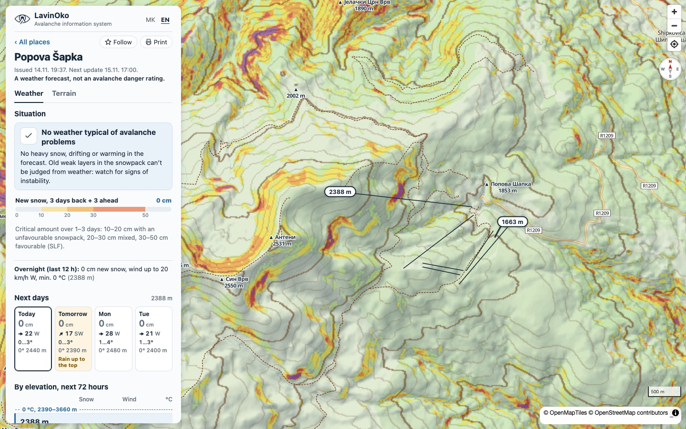
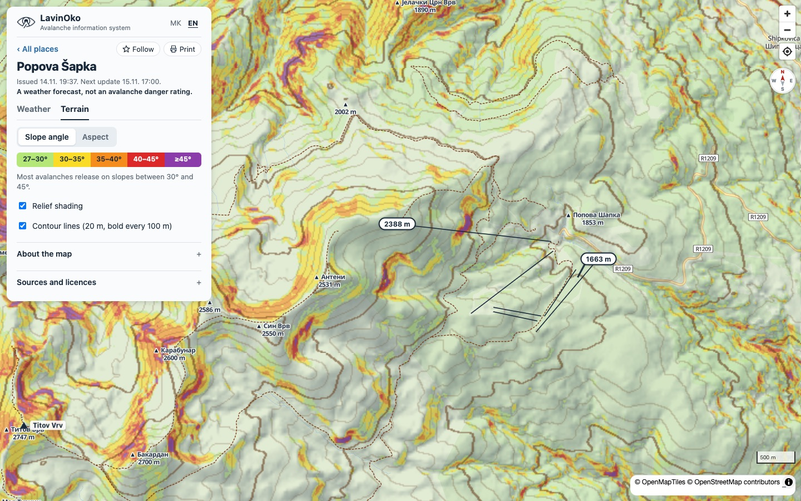
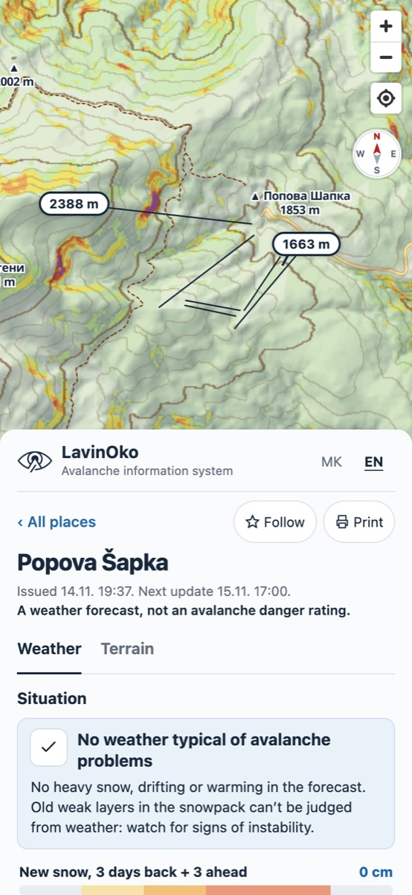

# LavinOko

*"Avalanche Eye"* — a free, open avalanche information service for the mountains of North Macedonia.
8 ski areas and 9 freeride/touring summits;

**Proof of concept: it shows terrain and weather, not avalanche danger.**

> 🚧 **Work in progress.** LavinOko is under active development and not yet deployed. Features, data and layout
> change often, and the forecasts have not been verified. Do not use it to make decisions in avalanche terrain.

## Screenshots

| Overview | Place (Popova Šapka) |
|---|---|
|  |  |

| Terrain: slope angle | Phone |
|---|---|
|  |  |

*Screenshots of the development build (`?lang=en`); the interface is also available in Macedonian.*

## What it does

- **Overview** of every place: new snow and wind for the next 72 h, alert level (attention / serious).
- **Per place:** situation (weather-driven avalanche problems: new snow, wind slab, wet snow), overnight summary,
  next days, forecast by elevation with freezing level, hour-by-hour chart.
- **Any point on the map:** coordinates, elevation, slope, aspect and a live 12-hour weather window (for rescuers).
- **Alerts** only when 2 of 3 independent models (ICON-EU, GFS, Météo-France) agree.
- **Terrain:** slope angle, aspect and relief from the Copernicus DEM, country-wide with extra detail around places.
- **Follow** places, **print** a one-page tour sheet (map, conditions, 112, plan), **offline** use.

## Layout

```
frontend/   SvelteKit site (static build); static/data/ is generated by the backend (not in git)
backend/    Python pipeline: terrain/ (PMTiles), weather/ (forecast + alerts), contract/ (data file shapes), tests/
config/     regions.json (places, forecast points), sources.json (licences and credits)
archive/    every forecast as issued, for later verification (local, not in git)
research/   incidents, Swiss comparison, user needs
docs/       open architecture decisions
```

## Run locally

Requires [uv](https://docs.astral.sh/uv/) and Node 22+.

```sh
cd backend
uv run python terrain/build_terrain.py     # ~2.5 min; downloads the DEM tiles once
uv run python weather/fetch_weather.py
uv run --with osmium python basemap/build_basemap.py   # optional: own base map (Java 21+, ~1.5 GB download once)
uv run --group dev pytest && uvx ruff check
uv run python -m contract.generate         # after changing contract/models.py: regenerate the frontend types

cd ../frontend
npm install
npm run dev                                # http://localhost:5173 (?lang=en)
npm run lint && npm run check              # ESLint; svelte-check (warnings fail)
npm run build && npm run size              # first page load must stay under 100 KB gzipped
npm run build && npm run preview           # production build with offline support
npm test                                   # Playwright, on the production build; needs static/data/
                                           # (backend output, or `npm run test:data` for the small test copy)
```

To add a place, add it to `config/regions.json` and run both backend scripts; `backend/tests/test_config.py` checks the file.

The shape of every file in `static/data/` is defined once, in `backend/contract/models.py`. The backend checks its
output against it before writing, so a run that would break the page publishes nothing. The frontend's types
(`src/lib/contract/types.gen.ts`) and the check it runs on every fetched file (`schema.gen.ts`) are generated from
it; CI fails if they are out of date. A file that fails the check on the page is never stored offline, and the last
good copy is shown instead.

## CI and deployment

`.github/workflows/ci.yml` runs lint, tests, type check and build on every push and pull request; for the frontend
also the 100 KB first-load budget and the Playwright tests, on the small test data in `frontend/tests/fixtures/data/`.
Nothing is deployed; hosting is an open decision (`docs/architecture/`).

## Data and licences

Only sources with a clear licence are used: Open-Meteo (CC BY 4.0, non-commercial), Copernicus DEM GLO-30,
OpenStreetMap (ODbL) and OpenMapTiles (base map built with `backend/basemap/build_basemap.py`). Required credits are in `config/sources.json` and shown in the app.
LavinOko stays non-commercial; several of these terms depend on it.

## Licence

Code: [MIT](LICENSE). Data from third parties keeps its own licence (see above).
The ЛавинОко / LavinOko name and logo (`logo/`) are not covered by the MIT licence.
