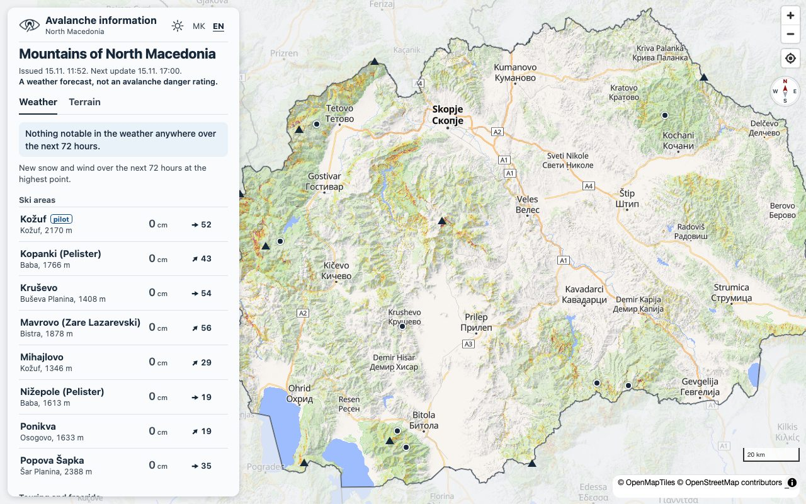

# LavinOko

*"Avalanche Eye"*: a free, open avalanche information service for the mountains of North Macedonia,
covering 8 ski areas and 9 freeride/touring summits.

LavinOko is the project. The site it builds is called **Лавински информации / Avalanche information** and only
credits "Project LavinOko".

> 🚧 **Proof of concept, not deployed.** It shows terrain and weather, **not avalanche danger**, and the forecasts
> have not been verified. Do not use it to make decisions in avalanche terrain.

| Overview | Place (Popova Šapka) |
|---|---|
|  |  |

| Terrain: slope angle | Phone |
|---|---|
|  |  |

## What it does

- **Overview:** new snow, wind and alert level for every place over the next 72 h.
- **Per place:** weather-driven avalanche problems, forecast by elevation with freezing level, hour-by-hour chart.
- **Any point on the map:** elevation, slope, aspect and a live 12-hour weather window.
- **Alerts** only when 2 of 3 weather models (ICON-EU, GFS, Météo-France) agree.
- **Terrain** layers from the Copernicus DEM. Also **print** a one-page tour sheet and use it **offline**.

Interface in Macedonian and English (`?lang=en`).

## Run locally

Requires [uv](https://docs.astral.sh/uv/) and Node 22+.

```sh
# 1. Generate the data (written to frontend/static/data/)
cd backend
uv run python terrain/build_terrain.py   # ~2.5 min the first time (downloads the DEM)
uv run python weather/fetch_weather.py

# 2. Start the site
cd ../frontend
npm install
npm run dev                              # http://localhost:5173/?lang=en
```

No Python? Run `npm run test:data` in `frontend/` instead of step 1. It copies a small sample, but the map shows no
terrain or base map.

<details>
<summary>Checks, production build, own base map</summary>

```sh
# backend/
uv run --group dev pytest && uvx ruff check
uv run python -m contract.generate                      # after editing contract/models.py
uv run --with osmium python basemap/build_basemap.py    # optional own base map (Java 21+, ~1.5 GB once)

# frontend/
npm run lint && npm run check      # ESLint, svelte-check
npm run build && npm run size      # first load must stay under 100 KB gzipped
npm run build && npm run preview   # production build with offline support
npm test                           # Playwright; needs static/data/
```

CI (`.github/workflows/ci.yml`) runs these on every push and pull request.
</details>

## Project layout

```
frontend/   SvelteKit static site
backend/    Python pipeline: terrain/, weather/, contract/ (shape of every data file), ates/ (draft terrain classes), tests/
config/     regions.json (places), sources.json (licences and credits)
docs/       architecture decisions (hosting is still open); the forecast archive is in StamenchoBog/lavinoko-archive
research/   incidents, Swiss comparison, user needs
```

To add a place, edit `config/regions.json` and rerun both backend scripts.

## Data and licences

Open-Meteo (CC BY 4.0, non-commercial), Copernicus DEM GLO-30, OpenStreetMap (ODbL) and OpenMapTiles.
Credits are in `config/sources.json` and shown in the app. LavinOko stays non-commercial, since several of these
terms require it.

Code is [MIT](LICENSE). The ЛавинОко / LavinOko name and logo (`logo/`) are not covered by the MIT licence.
